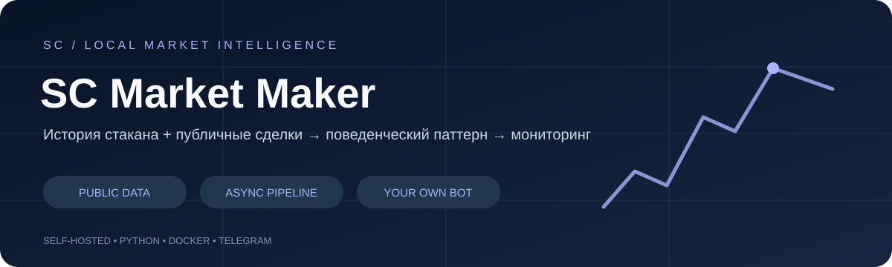
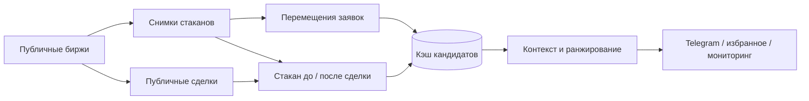

# SC Market Maker

[](https://github.com/salyahcrypto1-beep/sc-market-maker/actions/workflows/ci.yml)


**Переносимая версия @sc_market_maker_bot: наблюдение за поведением ликвидности по публичным стаканам и сделкам.**

Два независимых анализатора ищут повторяющиеся движения заявок и сохранение ликвидности вокруг исполненных сделок. Telegram-интерфейс объединяет найденные кандидаты, межбиржевые сравнения, поиск, избранное, чёрный список и мониторинг. Это детектор рыночных паттернов: он не выставляет ордера и не утверждает, что установил личность конкретного маркет-мейкера.

### Два взгляда на ликвидность

- **Активные перемещения:** одинаковый размер заявки при изменяющейся цене, повторяемость в последовательных окнах.
- **Восстановление/сохранение:** сопоставление публичной сделки со снимками стакана до и после неё.
- **Контекст:** спред, доступные биржи, глубина и подтверждённые сети перевода там, где API их раскрывает.
- **Персональная работа:** сохранение кандидатов, фильтры, поиск и уведомления по выбранным условиям.
- **Разделение нагрузки:** сборщики, два анализатора и Telegram работают независимо через общий кэш.



[Подробные схемы двух анализаторов →](docs/ARCHITECTURE.md)

## Быстрый запуск

Нужны **Docker Desktop с Docker Compose**, **Python 3.12+** для мастера настройки и доступ к этому приватному репозиторию. GPU, VPS, аккаунты бирж и биржевые API-ключи не нужны. Для Linux подойдёт Docker Engine с Compose plugin. На Windows используйте Docker Desktop с Linux containers/WSL2.

1. В Telegram откройте [@BotFather](https://t.me/BotFather), отправьте `/newbot` и создайте **своего** бота. Для второго проекта нужен второй токен.
2. Скачайте этот репозиторий через **Code → Download ZIP**, распакуйте и откройте терминал в папке проекта. Или клонируйте его через GitHub CLI после `gh auth login`.
3. Запустите мастер:

   ```bash
   python3 setup.py
   ```

   На Windows: `py -3 setup.py`. Вставьте токен в скрытый ввод. Мастер проверит его через Telegram `getMe`, создаст локальный `.env` и покажет команду привязки `/start КОД`.
4. Запустите Docker Desktop, дождитесь готовности движка и выполните:

   ```bash
   docker compose up -d --build
   ```

5. Отправьте показанную команду `/start КОД` **своему** боту в личном чате. Затем используйте обычный `/start`. Единственный пользователь установки сохраняется в локальной MongoDB, повторная привязка после перезапуска не нужна.
6. Проверьте получение данных:

   ```bash
   docker compose ps
   docker compose logs --tail=80 bot
   docker compose exec bot python -m portable.doctor
   ```

Первое скачивание образов и установка библиотек занимают время. После старта нужен прогрев потоков и окон анализа. Отсутствие сигнала само по себе не означает ошибку: рынки могут не проходить фильтры.

**Только Telegram-токен вводится как внешний секрет.** Код привязки генерируется автоматически, биржевые ключи не запрашиваются. Не вставляйте токен в GitHub, issue или чат с ИИ. `.env` исключён из Git и Docker build context.

### Сеть и VPN

Если биржа недоступна из вашей сети, включите **системный VPN**, разрешённый в вашей юрисдикции и правилами площадки. VPN только в браузере не меняет соединения Python/Docker. После изменения VPN при необходимости перезапустите Docker Desktop и контейнеры. Некоторые биржи ограничивают конкретные страны, дата-центры или VPN-адреса; VPN не гарантирует доступ.

```bash
docker compose exec bot python -m portable.doctor --network
```

`DNS`, `403`, `451`, `timeout` и `429` означают разные причины: DNS/маршрут, ограничение доступа, недоступность сервера или превышение частоты запросов. Не отключайте TLS-проверку и не добавляйте чужие API-ключи для решения сетевых ошибок.

### Нагрузка и охват

По умолчанию подписка ограничена **40 USDT-парами на биржу**, предпочтение — по доступному суточному обороту. Это стартовый профиль для ПК, а не полный охват рынка. В `.env` можно задать:

```dotenv
MAX_SYMBOLS_PER_EXCHANGE=40
EXCHANGES=kucoin,gate,bitget,mexc,bybit,bingx,htx,coinex,bitmart,okx
# Для одинакового набора на всех биржах:
SYMBOLS=BTC/USDT,ETH/USDT,SOL/USDT
```

`MAX_SYMBOLS_PER_EXCHANGE=0` включает все доступные spot USDT-пары и значительно увеличивает число подписок, RAM и сетевую нагрузку. `SYMBOLS` задаёт явный набор и имеет приоритет над лимитом. С ним подписка не ждёт REST-справочника рынков; неподдерживаемые пары отклонит сама биржа. Начните с малого, проверьте `docker stats`, затем расширяйте. Для первого запуска ориентируйтесь на современный 4-ядерный ПК с 8 ГБ RAM; это практическая отправная точка, не результат бенчмарка.

После изменения `.env`: `docker compose up -d --force-recreate bot`.

### Управление

| Задача | Команда |
|---|---|
| Старт | `docker compose up -d --build` |
| Остановка без удаления настроек | `docker compose down` |
| Логи | `docker compose logs --tail=100 -f bot` |
| Проверка данных | `docker compose exec bot python -m portable.doctor` |
| Проверка публичных API | `docker compose exec bot python -m portable.doctor --network` |
| Обновление после `git pull` | `docker compose up -d --build` |

MongoDB хранится в отдельном Docker volume. **Не используйте `docker compose down -v`, если хотите сохранить пользователей, настройки и избранное.** Обе сборки имеют разные имена Compose-проектов и могут работать одновременно с разными токенами. Один Telegram-токен нельзя одновременно использовать в двух polling-процессах: это вызывает Telegram `409 Conflict`.

При выключенном или спящем компьютере бот не работает. Автоперезапуск контейнеров действует, когда Docker запущен; это не облачный сервис.

## Технологии

| Компонент | Роль |
|---|---|
| Python 3.12 / asyncio | Параллельный сетевой ввод-вывод и независимые циклы |
| Собственные REST / WebSocket адаптеры | Прямые публичные подключения; без CCXT / CCXT Pro |
| aiohttp / aiohttp-socks | HTTP-запросы; исходные адаптеры сохранены для исследования |
| pyTelegramBotAPI / AsyncTeleBot | Telegram-команды, кнопки, сообщения и polling |
| APScheduler 3 | Периодические задачи исходных анализаторов |
| MongoDB 7 / Motor / PyMongo | Справочники рынков, профили и избранное |
| Memcached / pymemcache | Общие сжатые снимки стаканов и результаты между процессами |
| Redis 7 / redis-py | Совместимость исходного расчётного конвейера |
| NumPy, diskcache, jsons, Protobuf | Зависимости сохранённых вычислительных и биржевых модулей |
| Docker Compose | Изолированный запуск на macOS, Windows и Linux |
| pytest / GitHub Actions | Проверка математики, фильтров, импорта и сборки образа |

Версии и ограничения перечислены в [requirements.txt](requirements.txt). Снимки внутри приватной Docker-сети используют исторический формат gzip + pickle: не публикуйте Memcached/Redis наружу и не загружайте в них данные из недоверенных источников.

## Что входит в экспорт

Сохранены исходные алгоритмы, обработчики Telegram, справочник нормализации сетей, биржевые адаптеры и WebSocket-модули. Для действующих оптимизированных модулей взята именно серверная рабочая версия на 03.11.2026. Логи, базы клиентов, `.env`, старые резервные копии и история с секретами в Git не переносятся.

Запуск идёт через `portable/launch.py`. Стандартная сборка запускает исходные классы `newbot/webSockets/` через `portable/native_ws.py`. Публичные справочники и тикеры получает небольшой прямой HTTP-слой `portable/feeds.py` / `portable/native_rest.py`. CCXT не используется и не устанавливается. Старые подписывающие адаптеры не входят в активный путь. Не запускайте второй экземпляр сборщиков одновременно. Legacy-обогащение CoinMarketCap не запускается и не требует CMC-ключа.

## Передать проект своему ИИ-помощнику

Приватная ссылка работает только у GitHub-пользователей и инструментов с выданным доступом. Владелец добавляет человека через **Settings → Collaborators**; затем человек скачивает ZIP или клонирует репозиторий и открывает папку в локальном ИИ-агенте. Обычный веб-чат без доступа к компьютеру не сможет сам запустить Docker.

Готовый запрос — в [docs/AI_SETUP.md](docs/AI_SETUP.md); технические правила — в [AGENTS.md](AGENTS.md). Не передавайте ИИ GitHub-пароль или Telegram-токен: токен вводится пользователем в локальный мастер.

## Проверки и ограничения

См. [VALIDATION.md](VALIDATION.md), [docs/DATA_COVERAGE.md](docs/DATA_COVERAGE.md) и [CHANGELOG.md](CHANGELOG.md). Результаты — аналитические наблюдения на публичных данных, а не исполненные сделки. Комиссии торговли в исходных таблицах — расчётные предположения, не персональные актуальные тарифы аккаунта. Учитывайте задержку, глубину, доступность сетей и фактические условия биржи.
