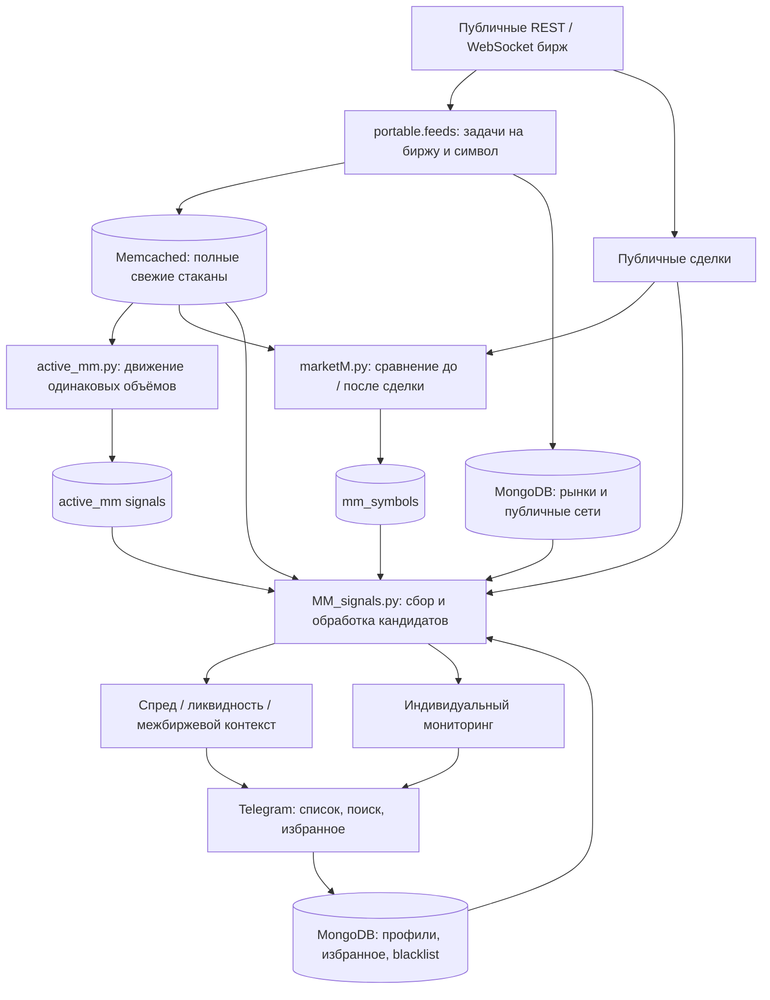
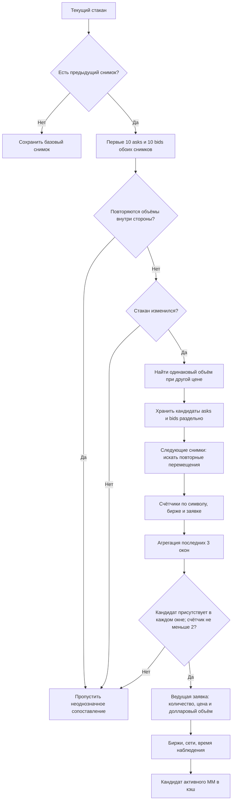
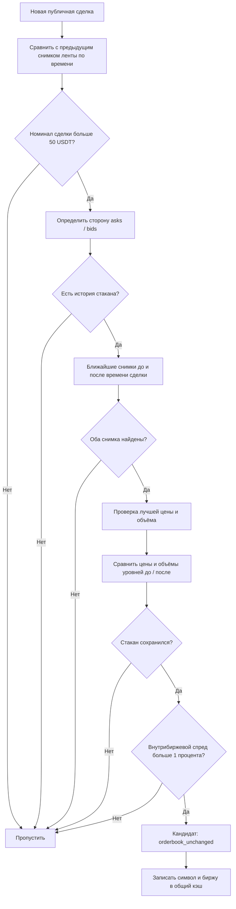
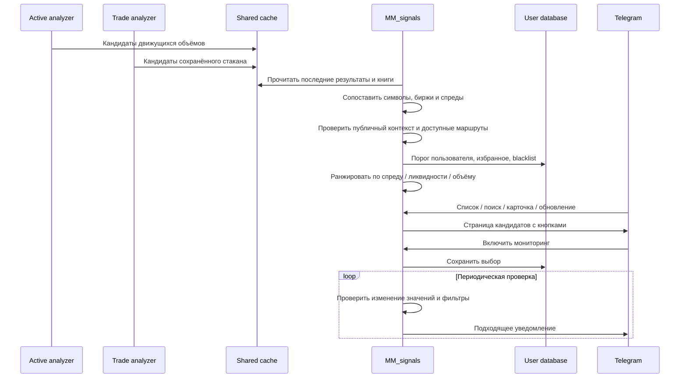
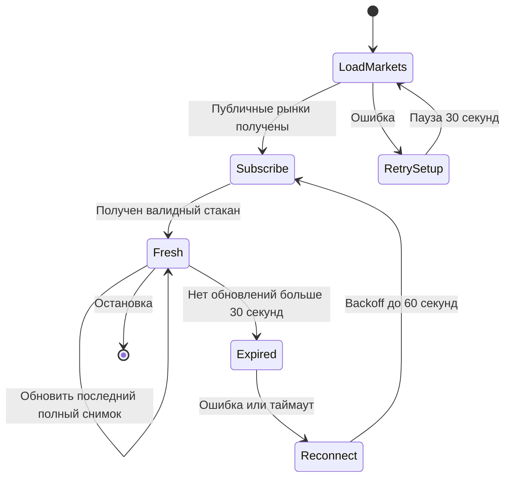

# Внутри SC Market Maker

Бот сопоставляет **динамику видимой ликвидности** и **публичную ленту сделок**. Его выход — кандидаты на характерное поведение маркет-мейкера, а не идентификация участника или гарантия будущего движения цены.

## 1. Независимые процессы

Один процесс не обязан ждать завершения полного цикла другого: обмен идёт через снимки в кэше и коллекции MongoDB. Сборщики имеют ограниченные таймауты и backoff, а Docker-супервизия восстанавливает группу процессов после аварийного завершения любого работника.

## 2. Активный паттерн: заявка меняет цену, сохраняя размер

Реализация: `OrderBookAnalyzer` в `MarketMaker/active_mm.py`.

Сопоставление объёма — эвристика: публичный агрегированный стакан обычно не содержит постоянного ID отдельного ордера. Две разные заявки могут иметь одинаковый размер, поэтому исходная стратегия отсеивает дубли объёмов в первых уровнях. Это снижает неоднозначность, но не устраняет её полностью.

В переносимой версии исправлена запись стороны: теперь `second_stage_comparison(..., side)` явно получает `asks` или `bids`. Раньше сторона определялась сравнением целых предыдущего и текущего списков и могла классифицироваться неверно.

## 3. Пассивный паттерн: ликвидность вокруг исполненной сделки

Реализация: `DataTokensCollector.process_trade` в `MarketMaker/marketM.py`.

В исходных комментариях встречается «100 долларов», но действующий порог в коде — **50 USDT**; схема отражает именно код. Объём исправлен на значение количества из стакана, а не ошибочный индекс цены.

Одинаковый стакан после сделки может означать восстановление ликвидности, но также зависит от частоты снимков, агрегации и задержки API. При отсутствии снимков по обе стороны сделки сигнал не строится. Дедупликация по времени из исходного алгоритма может объединять сделки с одинаковым timestamp — это известное ограничение.

## 4. Объединение кандидатов и личный мониторинг

В `MM_signals.py` сохранены ранжирование, сортировка, пагинация, поиск, обновление карточки, избранное и индивидуальные чёрные списки. Часть межбиржевых результатов зависит от проверенных сетей и известной комиссии вывода; неизвестная сеть не разрешается автоматически. Наблюдение стакана и возможность перевести актив — разные условия.

## 5. Сбор данных и восстановление

Для бирж, отсутствующих в установленной версии CCXT, CoinEx/BitMart имеют REST fallback с ограничением частоты; его временное разрешение ниже WebSocket. Снимки публикуются раз в секунду и считаются свежими 30 секунд. Профиль по умолчанию ограничивает число пар на биржу, поэтому анализ не равен полному охвату всех торгуемых активов.

## Карта алгоритмов и инструментов

| Модуль | Основная роль |
|---|---|
| `portable/feeds.py` | Параллельные публичные потоки, таймауты, TTL и справочники |
| `MarketMaker/active_mm.py` | Сопоставление равных размеров заявок при изменении цены |
| `MarketMaker/marketM.py` | История стаканов, публичная лента, сравнение до/после |
| `MarketMaker/MM_signals.py` | Объединение, расчёт контекста, ранжирование и Telegram |
| `MarketMaker/*_mm.py` | Сохранённые специализированные анализаторы; не запускаются параллельно стандартному стеку |
| `newbot/exchangeMethods/` | Сохранённый исходный биржевой слой и общий интерфейс |
| `portable/access.py` | Локальный владелец и собственные профили |

Заявления о конкретном количестве сигналов, доходности или точности определения участника требуют отдельной оценки на размеченных данных. В репозитории таких неподтверждённых обещаний нет.
