# SC Market Maker — подробная архитектура двух стратегий

Бот строит **две независимые гипотезы по публичным данным**: перемещение одинакового объёма между ценами и сохранение книги вокруг сделки. Затем объединяет кандидатов, добавляет межбиржевой контекст и отдаёт персональный список/мониторинг. Публичный L2-стакан агрегирует заявки по цене, поэтому обнаружение паттерна не идентифицирует конкретного участника.

## 1. Карта процессов и потоков данных

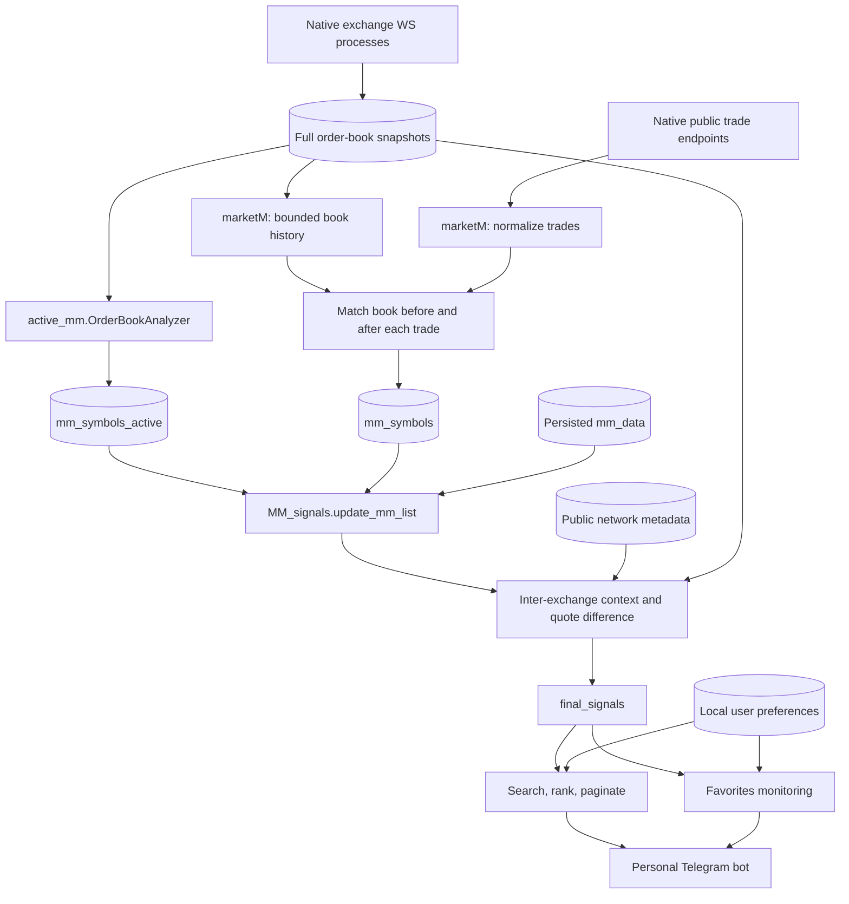

`marketM.py` и `active_mm.py` не вызывают друг друга. Кэш — граница процессов, а не общий Python-объект. `MM_signals.py` объединяет результаты позднее; пропажа одного источника не превращает другой в подтверждение первой стратегии.

## 2. Активный MM: состояние на пару token|exchange

Источник: [`active_mm.py`](../MarketMaker/active_mm.py): `analyze_orderbook`, `second_stage_comparison`, `third_stage_comparison`.

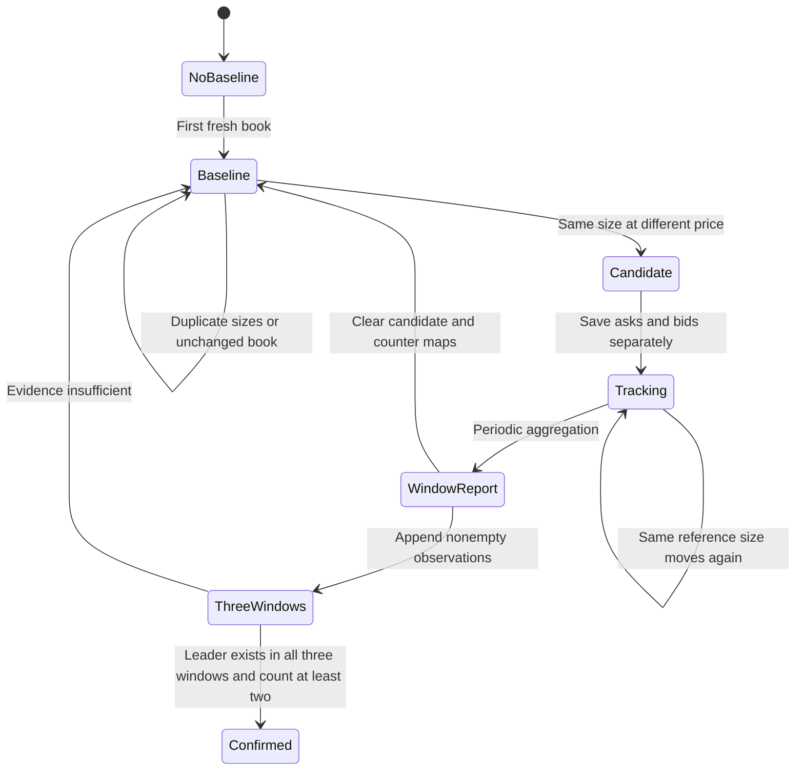

Первые 10 уровней каждой стороны ограничивают объём сравнений. Ключ `token|exchange` отделяет наблюдения разных рынков; `previous_snapshots` хранит базу сравнения, `initial_filtered_orders` — кандидатов по сторонам, `pattern_counts` — повторения конкретного исходного `[price,quantity]`.

## 3. Устранение неоднозначности до сопоставления

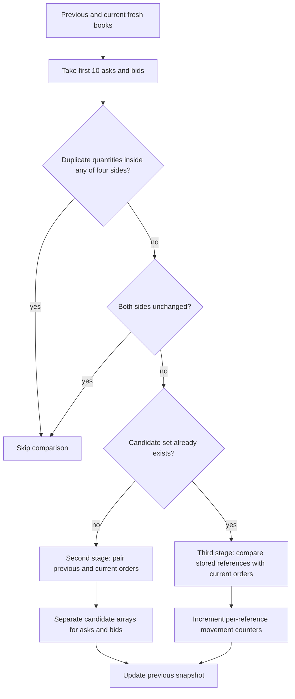

Если один размер встречается дважды, нельзя однозначно связать старый уровень с новым по количеству. Поэтому проверка дублей стоит **до** поиска совпадений. Сравнение каждой стороны ограничено 10×10 парами; это небольшая фиксированная матрица, а не сравнение всей глубины биржи.

На первом этапе совпадение означает `quantity_prev == quantity_current` и `price_prev != price_current`. На последующих этапах сравнение идёт с сохранённым первоначальным кандидатом. Это не проверка ID биржевого ордера: публичный поток его не предоставляет.

## 4. Подтверждение на нескольких окнах

Источник: `report_patterns`, `five_minute_analysis`, `start_cycle_result`.

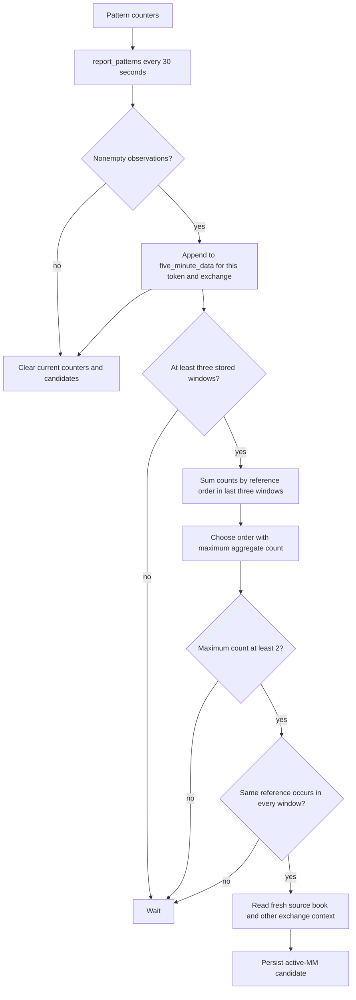

Не путать имя `five_minute_analysis` с длительностью доказательства: report настроен на 30 секунд, `start_cycle_result` запускает анализ раз в 240 секунд, а анализ берёт три **сохранённых непустых** окна. Это не гарантия трёх непрерывных минут или пяти минут. Пропущенные пустые окна в исходной структуре не создают явных нулевых наблюдений. Присутствие в каждом окне отсеивает единичные всплески, но временную плотность нужно оценивать отдельно.

## 5. Вторая стратегия: публичная сделка и книга вокруг неё

Источник: [`marketM.py`](../MarketMaker/marketM.py): `update_local_orderbooks`, `collect_trades_all_exs`, `process_trade`.

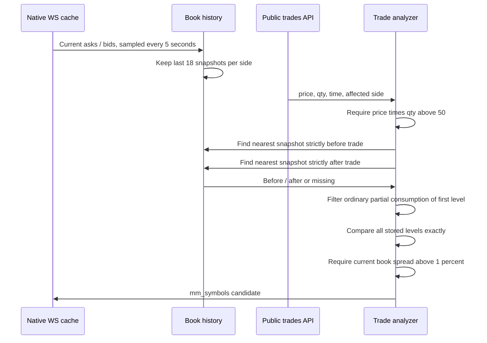

История ограничена 18 элементами на сторону: это ограничивает память и линейный поиск соседних снимков. При шаге 5 секунд ожидаемый горизонт порядка 90 секунд, но это не точная длительность при задержках. Timestamp истории ставится при считывании кэша, исходный `lastUpdate` хранится отдельно. Значит сопоставление идёт по sampled-наблюдениям, а не атомарному порядку всех событий биржи.

## 6. Все развилки process_trade

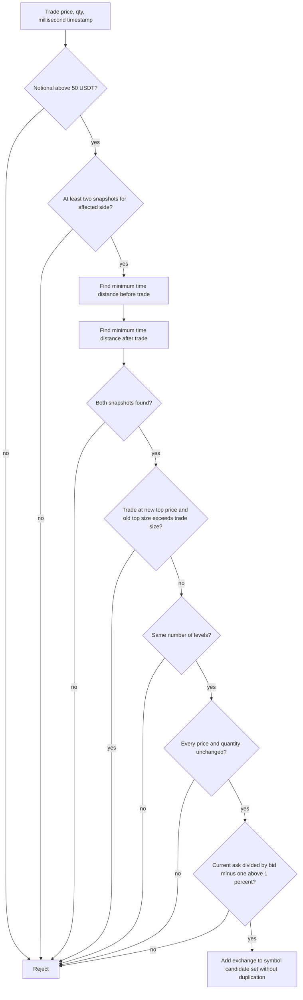

Порог действительно **50**, хотя старые комментарии говорили о 100. Условие первого уровня исключает часть обычных частичных исполнений. Остальная неизменность может указывать на восстановление ликвидности, но также зависит от дискретизации и качества ленты. Нельзя объявлять это доказанным «скрытым ордером» или гарантированным маркет-мейкером.

## 7. Объединение доказательств и накопленная память

Источник: `MM_signals.update_mm_list`, `save_mm_list_to_mongodb`.

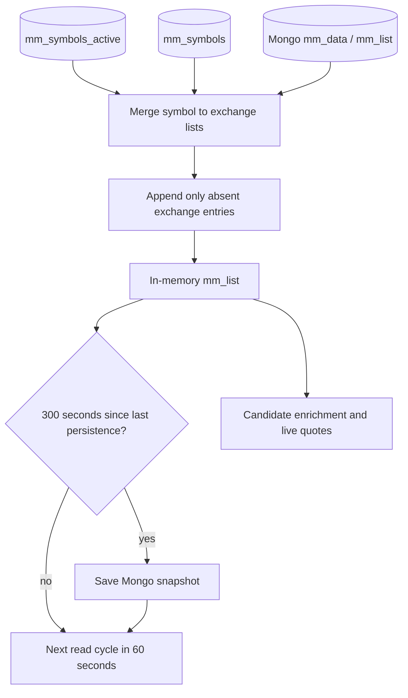

Это **накопленный список наблюдавшихся кандидатов**, а не автоматическое доказательство, что каждый участник активен прямо сейчас. Свежие стаканы, текущая разница цен и фильтры проверяются на следующем этапе. Исторический кандидат и исполнимый межбиржевой маршрут — разные сущности.

## 8. Межбиржевой контекст

Источник: `process_symbol`, `process_exchanges`, `detect_mm_signals`.

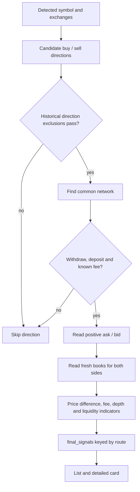

Не следует смешивать цену best bid/ask, спред внутри одной биржи и чистую прибыль исполнения по глубине. Это разные показатели разных этапов. MM-сигнал о паттерне не автоматически означает прибыльную арбитражную возможность. В текущем исходном `process_exchanges` выбирается последняя подходящая сеть в переборе, а не доказанно минимальная комиссия среди сетей; схема этого не скрывает.

## 9. Пользовательский список: фильтр до пагинации

Источник: `generate_active_mm_list`.

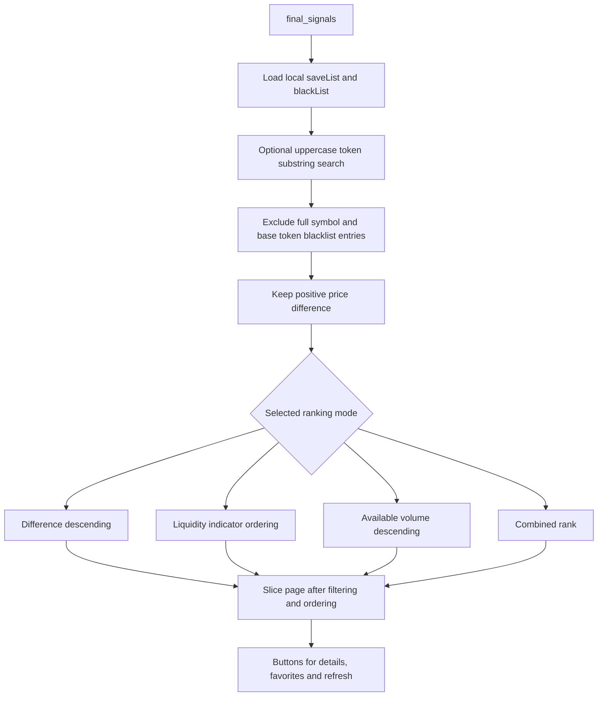

Личная сортировка не перезапускает сбор бирж и стратегии обнаружения. Пользователь меняет представление общего результата. Избранное и чёрный список хранятся в локальной MongoDB и переживают перезапуск контейнеров.

## 10. Мониторинг и обратная связь

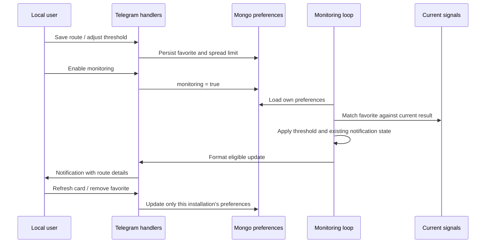

## 11. Почему архитектура разделена именно так

| Решение | Практический эффект | Чего оно не гарантирует |
|---|---|---|
| Два независимых детектора | Разные виды наблюдаемого поведения | Их сигналы не являются независимыми статистическими доказательствами |
| Top-10 и отказ от дублей размеров | Ограниченная цена сопоставления, меньше неоднозначности | Сохранение всех редких паттернов глубже стакана |
| Несколько окон | Отсечение одиночного движения | Непрерывность наблюдения между непустыми окнами |
| История 18 снимков | Ограниченная память и поиск соседей | Точный порядок событий между двумя snapshot |
| Отдельный UI/monitoring процесс | Интерфейс не вызывает детектор заново | Отсутствие любых блокирующих вызовов в старом коде |
| Нативные биржевые декодеры | Сохранение протокольных особенностей и оптимизаций | Одинаковое качество данных на всех площадках |

## Реальные границы реализации

Исходный сбор стаканов — **собственные адаптеры в `newbot/webSockets/`**, а не CCXT/CCXT Pro. Первая переносимая редакция ошибочно подменила их универсальной библиотекой; текущая редакция эту подмену устраняет. `portable/native_ws.py` запускает оригинальные классы в отдельных процессах. `portable/native_rest.py` — небольшой прямой HTTP-слой для публичных тикеров и выбора пар; это добавленная инфраструктура переносимости, не авторское расчётное ядро.

Серверные процессы проверены отдельно от наличия файлов: присутствие `client_auto.py` или альтернативного `*2.py` в архиве не означает, что файл участвует в работающем боте. Старый отдельный эксперимент `client_auto.py` с CCXT исключён из поставки. В репозитории остаются исходные специализированные адаптеры для изучения, но активный путь перечислен ниже.

### Транспорт по биржам

| Биржа | Реальный модуль | Особенность обработки |
|---|---|---|
| KuCoin | `newbot/webSockets/kucoin.py` | Публичный `bullet-public`; `level2Depth50`; последний raw-снимок и отложенный разбор |
| Bitget | `newbot/webSockets/bitget.py` | `books15`; выделение instId; замена pending-снимка; сортировка asks/bids |
| BingX | `newbot/webSockets/bingx.py` | Сжатые сообщения; heartbeat; последний raw-снимок перед разбором |
| HTX | `newbot/webSockets/htx.py` | Сжатие gzip, ping/pong, отложенная обработка полных depth-снимков |
| MEXC | `newbot/webSockets/mexc.py` | Бинарный Protobuf `PushDataV3ApiWrapper`; limited depth; backoff переподключения |
| Bybit | `newbot/webSockets/bybit.py` | Отдельная обработка snapshot/delta, обновление и удаление ценовых уровней |
| CoinEx | `newbot/webSockets/coinex.py` | Собственный декодер; локальная редакция обновлена на v2/spot, полные снимки; исходный поток на символ |
| Gate | `newbot/webSockets/gate.py` | Собственный WebSocket-клиент, `spot.order_book`, ограниченные полные снимки |
| BitMart | `newbot/webSockets/bitmart.py` | Менеджер подписок, собственный декодер и общий снимок |
| OKX | `newbot/webSockets/okx.py` | В локальной редакции `books5`: полные снимки; исправлен разбор дополнительных колонок |

KuCoin получает **публичный временный токен транспорта**, автоматически: это не персональный API-ключ биржи. Везде используются публичные потоки; кошелёк и торговые полномочия не запрашиваются.

### Почему отложенный JSON-разбор экономит работу

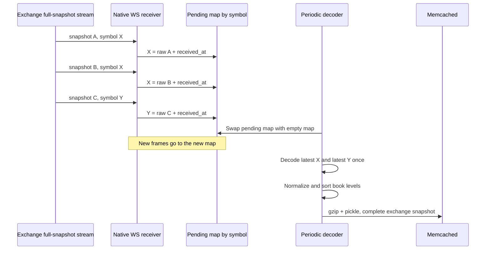

Это **coalescing полных снимков**: если пришло несколько самодостаточных книг одного символа, промежуточные можно заменить последней до дорогого JSON-разбора. Если за интервал пришло M кадров по S символам, количество разборов ограничено числом обновившихся символов, а не M. Эта логика применима только к полным снимкам. Для delta-потоков пропуск промежуточного обновления повреждает состояние: поэтому нельзя механически переносить оптимизацию KuCoin/Bitget в обработчик Bybit/CoinEx.

### От независимых потоков к единому формату

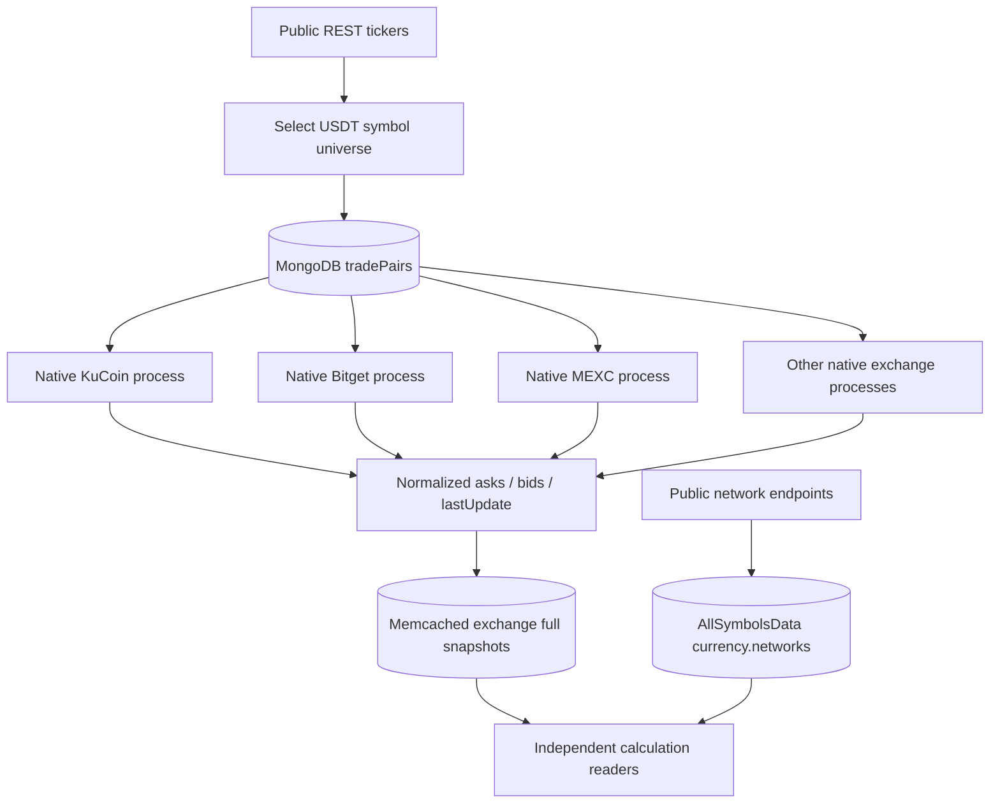

Формат — словарь `native_symbol → {asks, bids, lastUpdate}`. Имена бирж исторически различаются: MM использует `MEXC`, арбитраж — `MEXC Global`; адаптер совместимости зеркалирует ключ. OKX исходно писал per-symbol ключи; локальный runner объединяет их в полный снимок. Основные нативные сборщики публикуют примерно раз в 2 секунды с TTL 10 секунд; конкретный цикл смотрите в соответствующем `update_database`/`update_cache`, а не в универсальном обещании одинаковой частоты.

### Асинхронность и восстановление: что действительно параллельно

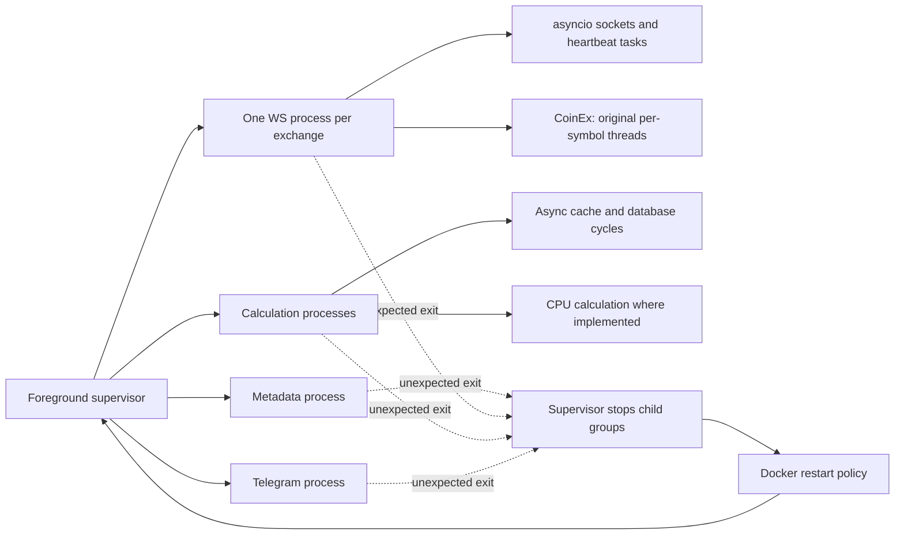

Процессы изолируют тяжёлые циклы друг от друга; `asyncio.gather` внутри процесса перекрывает ожидание сети, но не делает Python-математику автоматически многопроцессной. Синхронные обращения к кэшу в исходных модулях ещё есть. У бирж разные схемы reconnect; экспоненциальный backoff подтверждён, например, в MEXC, но не приписывается всем сборщикам.

TTL снимка и возраст конкретной книги — разные проверки: процесс может заново записать старую книгу и продлить TTL. Поэтому расчёты дополнительно проверяют `lastUpdate` (30 секунд), а пользовательский арбитражный расчёт — ещё и рассинхронизацию двух книг (10 секунд).

### Персональная локальная установка

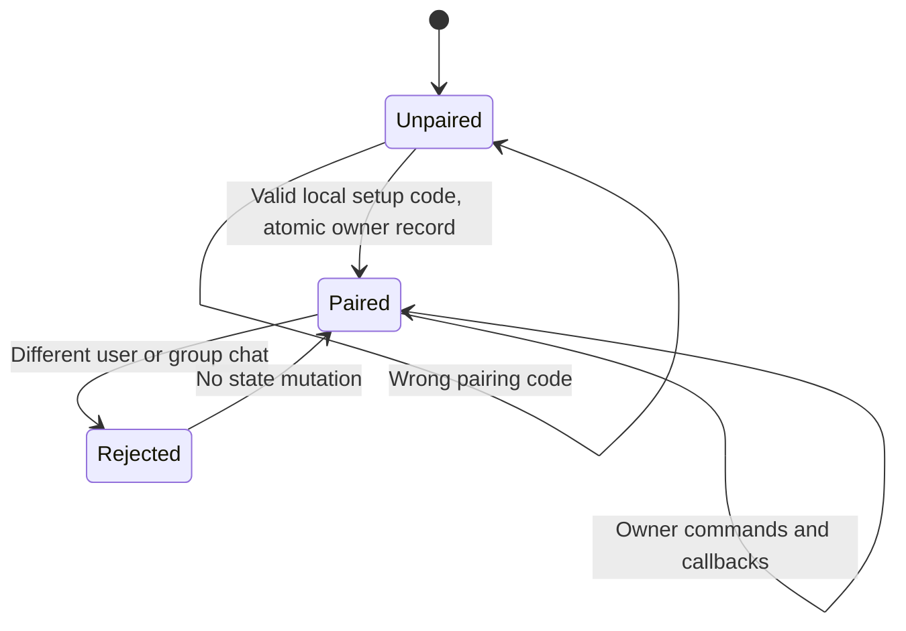

`portable/access.py` хранит одного локально привязанного пользователя. Middleware проверяет сообщения и callback до бизнес-обработчиков. Здесь нет специальной роли автора проекта, его ID, кнопок продажи доступа, добавления/удаления подписчиков, служебного управления общими списками или адреса поддержки владельца. Пользовательские настройки, избранное и личные чёрные списки сохранены.

### Проверяемость вместо декоративных обещаний

Схемы показывают вызовы и структуры данных, подтверждённые исходниками. Они не утверждают измеренную пропускную способность, точность определения маркет-мейкера или гарантированную прибыль. `VALIDATION.md` отделяет unit/import проверки, Docker-интеграцию и реальные сетевые пробы. Доступность API зависит от сети; данные о переводах описаны в [DATA_COVERAGE.md](DATA_COVERAGE.md).
